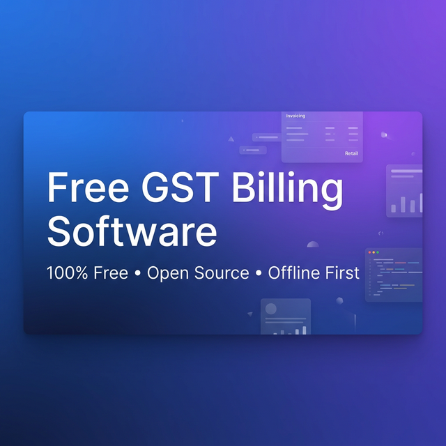

<p align="center">
  
</p>

<h1 align="center">Zephion Billkaro</h1>

<p align="center">
  <strong>Professional GST Invoice & Billing Software for India</strong><br>
  <em>by <a href="https://zephion.in">Zephion IT Solutions</a></em>
</p>

<p align="center">
  <a href="#features">Features</a> •
  <a href="#screenshots">Screenshots</a> •
  <a href="#tech-stack">Tech Stack</a> •
  <a href="#installation">Installation</a> •
  <a href="#development">Development</a> •
  <a href="#deployment">Deployment</a> •
  <a href="#support">Support</a>
</p>

---

## About

**Zephion Billkaro** is a full-featured, offline-first GST billing and invoicing application built for Indian businesses of all sizes — from freelancers and small shops to multi-GSTIN enterprises. It runs entirely on your computer with no cloud dependency, keeping your financial data private and under your control.

> [!NOTE]
> This project is based on [Free GST Billing Software](https://github.com/IamRamgarhia/Free-GST-Billing-Software), originally created by DiceCodes. It is distributed under the MIT License. See [LICENSE](LICENSE) for full terms and original copyright.

---

## Features

### Invoicing
- **Tax Invoice**, Proforma Invoice, Credit Note, Debit Note, Bill of Supply, Delivery Challan
- Multi-currency invoicing for **22+ countries** (USD, EUR, GBP, AED, AUD, SGD, and more)
- Per-line custom units (kg, ltr, mtr, etc.) with UQC codes
- Rich-text Terms & Conditions with 13 India business presets
- UPI QR code on invoices for instant payments
- Barcode / SKU scanning support
- Invoice templates with customizable design (Boxed, Tally-style)

### GST Compliance
- **GSTR-1** JSON export with HSN summary
- **GSTR-3B** JSON export
- **GSTR-2B** reconciliation (JSON import + matching)
- **e-Way Bill** JSON generation
- **TDS / TCS** reports — Form 26Q, Form 27EQ
- Section 194Q, 194C, 194J, 206C support
- LUT / SEZ export invoicing with place-of-supply override
- e-Invoice (IRN) JSON for IRP

### Business Management
- Multi-business profile switching (multi-GSTIN)
- Client management with opening balances and ledger
- Product / service inventory with stock tracking
- Purchase orders, purchase bills, debit notes
- Expense tracking and receipt vouchers
- Cash book with daily / monthly views
- Recurring invoice automation
- Manufacturing / production entries with stock movement
- Multi-account payment tracking
- Income tax (ITR) aids

### Reports & Analytics
- Dashboard with financial summaries and charts
- Profit & Loss reports
- Stock reports with reorder alerts
- Client outstanding / receivable reports
- Supplier statements
- TDS / TCS collected & receivable reports
- COGS (Cost of Goods Sold) reporting

### Data & Security
- **100% offline** — your data stays on your machine
- Granular backup with optional **Google Drive sync**
- Import / export (JSON, CSV, Tally XML)
- PIN lock and period lock (close the books)
- Edit history audit trail
- PDF generation and print (thermal, A4, A5)
- Share invoices via WhatsApp PDF
- Phone / tablet access on the same Wi-Fi network

---

## Screenshots

<p align="center">
  
</p>

> More screenshots are available in the [docs/screenshots](docs/screenshots) directory.

---

## Tech Stack

| Layer | Technology |
|-------|-----------|
| **Frontend** | React 19, Vite 7, Lucide Icons |
| **Backend** | Node.js 18+, Express 5 |
| **PDF** | jsPDF, html2canvas, pdf-lib |
| **PWA** | vite-plugin-pwa, Workbox |
| **OCR** | Tesseract.js 7 |
| **QR** | qrcode |
| **Desktop** | WebView2 (Windows), native launcher (macOS) |
| **Fonts** | Inter (bundled, @fontsource) |

---

## Installation

### Quick Install (Windows)

```powershell
powershell -ExecutionPolicy Bypass -c "[Net.ServicePointManager]::SecurityProtocol='Tls12'; irm https://raw.githubusercontent.com/zephioncontact-tech/Billkaro/main/install.ps1 | iex"
```

### Quick Install (macOS / Linux)

```bash
curl -fsSL https://raw.githubusercontent.com/zephioncontact-tech/Billkaro/main/install.sh | bash
```

### Windows Setup (EXE Installer)

Download the latest `Zephion-Billkaro-Windows-Setup.exe` from [GitHub Releases](https://github.com/zephioncontact-tech/Billkaro/releases).

### Docker

```bash
docker compose -f packaging/docker/docker-compose.yml up -d
```

### Manual (ZIP)

1. Download and extract the latest release ZIP from [Releases](https://github.com/zephioncontact-tech/Billkaro/releases)
2. Ensure **Node.js 18+** is installed
3. Run `npm install` in the extracted folder
4. Run `npm start`
5. Open `http://localhost:47371` in your browser

---

## Development

### Prerequisites

- **Node.js** 18.0.0 or higher
- **npm** (comes with Node.js)

### Setup

```bash
# Clone the repository
git clone https://github.com/zephioncontact-tech/Billkaro.git
cd Billkaro

# Install dependencies
npm install

# Start the development server (Vite + Express)
npm run dev        # macOS / Linux
npm run dev:win    # Windows
```

The app will be available at `http://localhost:5173` (Vite dev server), with API requests proxied to Express on port 47371.

### Project Structure

```
├── src/                  # React frontend
│   ├── components/       # UI components (JSX)
│   ├── services/         # Google Drive integration
│   ├── utils/            # Business logic, calculations, PDF
│   ├── App.jsx           # Main application component
│   ├── main.jsx          # Entry point, SW registration
│   └── index.html        # HTML template (Vite root)
├── server.js             # Express API server (~3500 lines)
├── scripts/              # Build, test, and release scripts
├── installer/            # Windows Setup (Inno Setup)
├── packaging/            # Docker, Linux (.deb, AppImage), macOS
├── release-templates/    # Release ZIP template files
├── docs/                 # Technical documentation
├── docs-site/            # Documentation website generator
├── tests/                # Smoke tests and design baselines
├── public/               # Static assets, icons, SW
└── vite.config.js        # Vite + PWA configuration
```

### Available Scripts

| Command | Description |
|---------|-------------|
| `npm run dev` | Start dev server (macOS/Linux) |
| `npm run dev:win` | Start dev server (Windows) |
| `npm run build` | Production build |
| `npm start` | Build + start Express server |
| `npm run lint` | Run ESLint |
| `npm test` | Run all unit tests + smoke test |
| `npm run test:unit` | Run unit tests only |
| `npm run release:zip` | Lint, test, build, and create release ZIP |
| `npm run release:exe` | Build Windows Setup installer |
| `npm run release:deb` | Build Linux .deb package |

---

## Build

### Production Build

```bash
npm run build
```

Outputs optimized static files to `dist/`.

### Release ZIP

```bash
npm run release:zip
```

Creates a distributable ZIP with the app, scripts, and bundled assets.

### Windows Installer

```bash
npm run release:exe
```

Requires [Inno Setup](https://jrsoftware.org/isinfo.php) installed.

### Linux Packages

```bash
npm run release:deb        # Debian/Ubuntu .deb
npm run release:appimage   # AppImage
npm run release:linux      # All Linux formats
```

### Docker

```bash
npm run release:docker
```

---

## Deployment

### Self-Hosted (Recommended)

Zephion Billkaro is designed as a local-first application. For best security and privacy:

1. Install on each user's workstation
2. Data stays on the local machine
3. Optional Google Drive backup for cloud sync

### Docker Deployment

```bash
docker compose -f packaging/docker/docker-compose.yml up -d
```

> [!WARNING]
> Zephion Billkaro is a single-user application. Do not expose it directly to the internet without proper authentication. See [docs/DEPLOY_ONLINE.md](docs/DEPLOY_ONLINE.md) for details.

---

## Support

| Channel | Link |
|---------|------|
| **Website** | [zephion.in](https://zephion.in) |
| **Email** | [zephion.contact@gmail.com](mailto:zephion.contact@gmail.com) |
| **GitHub Issues** | [Report a bug or request a feature](https://github.com/zephioncontact-tech/Billkaro/issues) |
| **Documentation** | [docs/](docs/) |

---

## About Zephion IT Solutions

**Zephion IT Solutions** builds software tools for Indian businesses — billing, compliance, and productivity solutions that work offline-first and respect your data privacy.

- 🌐 Website: [zephion.in](https://zephion.in)
- 📧 Email: [zephion.contact@gmail.com](mailto:zephion.contact@gmail.com)
- 🐙 GitHub: [github.com/zephioncontact-tech](https://github.com/zephioncontact-tech)

---

## License

This project is licensed under the **MIT License** — see the [LICENSE](LICENSE) file for details.

> **Attribution:** This project is based on [Free GST Billing Software](https://github.com/IamRamgarhia/Free-GST-Billing-Software) originally created by [DiceCodes](https://dicecodes.com). The original copyright and license terms are preserved in the LICENSE file as required.
